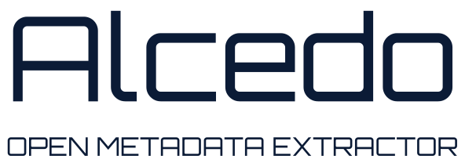

<p align="center">
  
  <br>
  <picture>
    <source media="(prefers-color-scheme: dark)" srcset="https://raw.githubusercontent.com/Prostochell-544/Alcedo/main/docs/assets/alcedo-wordmark-dark.svg">
    
  </picture>
</p>

# Alcedo

*Alcedo* is the Latin name of the kingfisher, which dives and picks out exactly what it wants.

Alcedo turns a list of literature search queries into DOIs grouped by query. Put your
boolean queries in a file and run one command. The results are a text file with one
block per query. There is no export to reference managers yet.

**Status: alpha.** Options may change. See the [roadmap](https://github.com/Prostochell-544/Alcedo/blob/main/docs/ROADMAP.md) and the [changelog](https://github.com/Prostochell-544/Alcedo/blob/main/CHANGELOG.md).
Documentation in other languages: [Russian](https://github.com/Prostochell-544/Alcedo/blob/main/docs/ru/query-rules.md), [Ukrainian](https://github.com/Prostochell-544/Alcedo/blob/main/docs/uk/query-rules.md).

## What it does

- Takes up to 5 result pages (50 results) per query, or all of them if there are fewer.
- Searches Google Scholar through a search API with your own key. Without a working API it uses Semantic Scholar and
  OpenAlex, plus direct Google Scholar search if you turned that on. See [Which source to use](#which-source-to-use).
- A source that fails is left out, and the block says so.
- Scholar gives links rather than DOIs, so Alcedo looks for the DOI in the URL, Europe PMC and
  publisher meta tags, then by title in Crossref and OpenAlex.
- Saves after every query. `--resume` continues after an interruption and collects failed queries again.
- Writes a second file listing each DOI once, with the queries that found it. Papers found by the most queries come first.
- With `--verify-dois`, checks every DOI in the doi.org registry and marks the ones that do not exist.

## Install

Requires Python 3.10 or newer.

```bash
pip install alcedo-lit
```

For direct Google Scholar search, which most people will not need, install the extra as well:
`pip install "alcedo-lit[scholar]"`.

Then choose how to search. This explains the options and saves your key, which is not shown as you type:

```bash
alcedo setup
```

## Quick start

The repository includes a sample: [queries.txt](https://github.com/Prostochell-544/Alcedo/blob/main/queries.txt) has two queries about the kingfisher, and
[alcedo_results.txt](https://github.com/Prostochell-544/Alcedo/blob/main/alcedo_results.txt) and [alcedo_results_unique.csv](https://github.com/Prostochell-544/Alcedo/blob/main/alcedo_results_unique.csv) are their
results. There is another set of queries in [examples/queries.txt](https://github.com/Prostochell-544/Alcedo/blob/main/examples/queries.txt).

For your own search, create a `queries.txt` in any folder, with `;` after each query:

```text
biomimetic nacre ("brick-and-mortar" OR "layered structure") composite fracture toughness;
gecko-inspired dry adhesive (micropillar OR "hierarchical microstructure") adhesion;
```

From that folder, check the queries for common mistakes and then run them:

```bash
alcedo check
alcedo
```

The results go to `alcedo_results.txt` in the current folder:

```text
=== Query: gecko-inspired dry adhesive (micropillar OR "hierarchical microstructure") adhesion ===
Source: OpenAlex
https://doi.org/10.1039/c3sm52921e
https://doi.org/10.1098/rsif.2018.0681
```

The `Source:` line appears when the results did not all come from a search API. Records with no DOI are
listed as `DOI not found: <title>`, and a query that failed has a `Query error` line. If DOI
lookups failed along the way, the final message says how many, because those records may still have a DOI.

Alcedo will not replace an existing results file: use `--resume` to continue it or `--overwrite` to start again.

`alcedo_results_unique.csv` lists each DOI once, with the number of queries that found it and the queries themselves.
It is built from the results file and uses no extra searches. Cells are separated by `;`, which Excel in European
locales expects.

To check DOIs against the doi.org registry, add `--verify-dois`. This also works on results you already have:
`alcedo --resume --verify-dois`. A DOI the registry does not know becomes `DOI not registered: <doi>`, and one that
could not be checked stays in the results and is counted in the final message. The check uses no OpenAlex budget.

To check the wording of a query quickly, look at its first 10 results:

```bash
alcedo --pages 1 -i test.txt -o test_results.txt --overwrite
```

Read [how to write queries](https://github.com/Prostochell-544/Alcedo/blob/main/docs/query-syntax.md) before a large run. Some mistakes fail silently: a lowercase
`or`, for example, is treated as AND. `alcedo check` finds the common ones.

## Which source to use

With a working API key, a query uses only the API. Otherwise it uses the free sources together, in this order:
Semantic Scholar, OpenAlex, and direct search if you turned it on. Each gives up to 50 results and repeats are
removed, so a block can hold more than 50 records. A source that fails is left out, and the `Source:` line says so.
If every source fails, the block has a `Query error` line and `--resume` collects it again.

The free options do not give the same results as an API. The figures below come from small tests with relevance
judged by an AI assistant, not by a domain expert. Treat them as a rough guide. Results vary a lot by query.

| Source | What you need | Cost at the time of writing | How it did |
|---|---|---|---|
| Google Scholar via [SearchApi](https://www.searchapi.io) | Your key, no phone number | 100 free requests to try it, then from $40 a month | Best first results: 13 of the first 20 were exactly on topic. Same first results as a browser in our check |
| Google Scholar via [Serper](https://serper.dev) | Your key, no card | 2,500 free queries, which is about 500 queries of 50 results, then one-off packs from $50 for 50,000, valid for 6 months | Same first 10 results as SearchApi on both test queries, and 13 of the first 20 exactly on topic. Later results differed |
| Google Scholar via [SerpApi](https://serpapi.com) | Your key and a phone number | 250 free searches a month, paid plans from $25 a month | Not measured; Alcedo has not yet been run against the live service |
| [Semantic Scholar](https://www.semanticscholar.org/product/api) | Nothing; a free key gives you your own limit | Free | 9 of the first 10 exactly on topic on one query, no results on a stricter one. Finds few but precise papers, most cited first. Not measured inside Alcedo |
| OpenAlex | Nothing; a [free key](https://openalex.org/settings/api) raises the daily budget | Free | 5 of the first 20 exactly on topic. Its share of on-topic results ranged from 34% against 73% for the API to about equal. It also found papers Scholar missed |
| Google Scholar directly | `pip install "alcedo-lit[scholar]"` and your agreement | Free | Changes a lot between runs and networks, see below |

A query with 50 results uses 3 requests on SearchApi and 5 on Serper. You create the key and accept the provider's terms, and the
provider sees your queries. If you have neither a key nor a budget for one, the free catalogues still work, and direct
search can add to them on a network Scholar accepts.

In a run where Scholar answered in full, the free sources together found 38 of the 45 exactly on-topic papers known
from all our runs, against 29 for SearchApi. Their first results were weaker, with 9 of the first 20 exactly on topic
against 13, and they took 15 minutes for 2 queries against 3.5, mostly on direct search and DOI lookups. A key gives you
the best first results quickly, but going without one does not have to mean missing papers.

Publications that use results from Semantic Scholar should cite the Semantic Scholar Open Data Platform, as its
[API license](https://www.semanticscholar.org/product/api/license) asks.

### Direct search

It is free, and Scholar may simply refuse it. Scholar often refuses VPNs and shared networks: in our test, one VPN
provider was refused even in a browser and another was accepted. If it refuses you, try without the VPN, and check
the same search in a browser.

**An answer from Scholar does not mean the list is complete.** In some of our tests, the script got 6 to 27 results
for queries that give 50 through an API, mostly recent papers, with key works missing, and repeating one query gave
different lists. In a later run it got all 50, nearly all of them also in the API's list. Parsing does not explain the
difference, we do not know the cause, and you cannot tell in advance which you will get. So Alcedo puts direct results after the free catalogues,
where they can only add to the list, and marks those blocks in the results file. Do not rely on direct search for a
literature review. If you add a key later, `alcedo --redo-free` collects those blocks again.

Alcedo asks once before using direct search, and remembers your answer. `alcedo setup` changes it, and
`--direct-scholar` or `--no-direct-scholar` overrides it for one run.

### Keys and everyday commands

`alcedo setup` stores keys as plain text in your user settings (`%APPDATA%\alcedo\config.json` on Windows,
`~/.config/alcedo/config.json` elsewhere). Run it again and type `-` to remove a key. The `SEARCHAPI_KEY`,
`SERPER_API_KEY`, `SERPAPI_KEY`, `OPENALEX_API_KEY` and `SEMANTIC_SCHOLAR_API_KEY` environment variables take priority
over that file, and command line options take priority over both.

```bash
alcedo --resume          # continue after an interruption
alcedo --redo-free   # collect blocks from the free sources again, for example after adding a key
alcedo --source openalex # OpenAlex only
alcedo --no-semantic-scholar  # leave Semantic Scholar out of the free sources
alcedo --help            # all options
```

## Responsible use

- Direct Google Scholar search is off until you agree to it. Scholar's `robots.txt` disallows automated search, and
  you are responsible for following Google's terms. Alcedo waits between queries and stops asking when Scholar
  refuses. The `scholarly` library it relies on sends a random browser User-Agent and may try to open a browser for
  a captcha, and it has no setting to turn that off.
- Apart from that route, requests identify themselves as `alcedo/<version>`. With `--mailto`, your
  address goes to Crossref, OpenAlex, Semantic Scholar and Europe PMC, never to publisher sites.
- Alcedo collects metadata. It does not download papers and will not integrate shadow libraries.

## Development

```bash
pip install -e ".[dev]"
python -m pytest
ruff check .
```

The tests use no network. Git tracks the sample in the project root, so do not run your own queries there:
`queries.txt`, `alcedo_results.txt` and `alcedo_results_unique.csv` would show up as changes. Use `private/`, which
Git ignores, so your topic stays out of the repository.

## License

The code is under the [MIT](https://github.com/Prostochell-544/Alcedo/blob/main/LICENSE) license. The logo is not: see the [third-party notices](https://github.com/Prostochell-544/Alcedo/blob/main/THIRD_PARTY_NOTICES.md).

## Special thanks

To [kesha_xdd](https://t.me/kesha_xdd), who drew the Alcedo logo.
